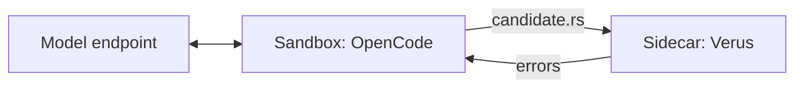

# Verus on Modal Sandboxes

A proof eval is a loop: a model writes a proof, Verus checks it, and the model tries again
with the errors. These examples build that loop on [Modal Sandboxes](https://modal.com/docs/guide/sandboxes)
one piece at a time, around three questions:

1. **Can we run one Sandbox per problem, thousands at a time?** [verify.py](verify.py), [fanout.py](fanout.py)
2. **What can a Sandbox reach, and what can it see?** [network.py](network.py), [proxy.py](proxy.py)
3. **How do the agent, the model, and the verifier fit together?** [endpoint.py](endpoint.py), [agent.py](agent.py)

Every example checks the same small problem: prove that a function returns the maximum of a
vector. The [contract](contract/) holds the fixed spec, an incomplete
[candidate](contract/candidate.rs), and a [solution](contract/solution.rs).

| Example | Shows | One run (nicolas-dev, 2026-10-21) |
| --- | --- | --- |
| `verify.py` | One verifier with no network | 3.0 s Verus time |
| `fanout.py` | 500 verifiers in parallel | 500/500 verified in 7.5 s |
| `network.py` | Open, blocked, and allowlisted egress | 6/6 outcomes as expected |
| `proxy.py` | The model key lives only in a Sidecar | key absent, direct: no connection, proxy: HTTP 200 |
| `endpoint.py` | Several Sandboxes share one model endpoint | 4 requests in 2.1 s |
| `agent.py` | OpenCode writes the proof, a Sidecar verifies it | verified in 14.3 s |

Every example runs the same way:

```bash
uv run modal run <example>.py
```

## Setup

Install [uv](https://docs.astral.sh/uv/getting-started/installation/), then:

```bash
uv sync --frozen
uv run modal setup   # Skip if already authenticated.
```

The examples use your active Modal profile and environment, and terminate their Sandboxes when
they finish. The first Verus run builds the [Image](https://modal.com/docs/guide/images), which
takes a few minutes; later runs reuse it.

`proxy.py`, `endpoint.py`, and `agent.py` also need a model. Copy `.env.example` to `.env` and fill in:

- `MODEL_URL` and `MODEL_NAME`: the base URL (ending in `/v1`) and model name from your
  [endpoint's](https://modal.com/endpoints) request example. The agent needs tool calling; Kimi K3 works.
- `MODEL_KEY`: a [proxy token](https://modal.com/settings/proxy-auth-tokens) for the endpoint's
  workspace, written as `wk-<id>.ws-<secret>`.

## 1. One Sandbox per problem

[verify.py](verify.py) creates a Sandbox with `block_network=True`, uploads the contract and a
candidate through the [filesystem API](https://modal.com/docs/guide/sandbox-files), and runs Verus.
Uploads and [exec](https://modal.com/docs/guide/sandbox-spawn) go through Modal, so they work
without a network.

```bash
uv run modal run verify.py                                # The solution verifies.
uv run modal run verify.py --path contract/candidate.rs   # The incomplete proof is rejected.
```

[fanout.py](fanout.py) starts 500 of those Sandboxes at once with the
[async API](https://modal.com/docs/guide/async). The inputs are baked into the image, so each
Sandbox runs Verus as soon as it starts. The time covers creation, verification, and cleanup.

```bash
uv run modal run fanout.py               # 500 Sandboxes.
uv run modal run fanout.py --count 5000  # Your workspace's container limit applies.
```

## 2. Sandbox networking

Sandboxes run under [gVisor](https://gvisor.dev), and each one gets its own
[network policy](https://modal.com/docs/guide/sandbox-networking).

### Network policies: [network.py](network.py)

```bash
uv run modal run network.py
```

Probes two hosts under three policies:

| Policy | modal.com | example.com |
| --- | --- | --- |
| Default | reachable | reachable |
| `block_network=True` | unreachable | unreachable |
| `outbound_domain_allowlist=["modal.com"]` | reachable | unreachable |

### Keep the model key in a proxy: [proxy.py](proxy.py)

```bash
uv run modal run proxy.py   # Needs .env.
```

An allowlist lets a Sandbox reach the model, but code in the Sandbox can still read the model key.
This example moves the key into a [Sidecar](https://modal.com/docs/guide/sandbox-sidecars): a Caddy
container next to the Sandbox that adds the key to each request. The Sandbox has
`outbound_cidr_allowlist=[]`, so it reaches the Sidecar and nothing else. The script checks that
the key is absent, a direct request fails to connect, and a request through the proxy gets HTTP 200
even though it carries an invalid key.

Sidecars are in beta and use `_experimental_sidecars` in the pinned SDK.

## 3. Agent, model, and verifier

[endpoint.py](endpoint.py) sends one chat request from each of several Sandboxes to the same
endpoint. Each Sandbox can reach only the model host.

```bash
uv run modal run endpoint.py --count 20
```

Sandboxes and the endpoint scale separately. A [Dedicated Endpoint](https://modal.com/docs/guide/dedicated-endpoints)
adds replicas as concurrent requests grow, so more Sandboxes bring more replicas, within its limits.
A [Shared Endpoint](https://modal.com/docs/guide/shared-endpoints) returns HTTP 429 when its pool
is busy; lower `--count` if you see that. This script checks concurrent requests. It does not
measure replica scaling.

[agent.py](agent.py) runs the full loop with two trust levels:

```bash
uv run modal run agent.py
```



| | Agent Sandbox | Verifier Sidecar |
| --- | --- | --- |
| Runs | OpenCode, edits `candidate.rs` | [verifier.py](support/verifier.py), checks source it receives |
| Network | the model host only | none |
| Contract | a copy of `spec.rs` to read | its own `main.rs` and `spec.rs`, baked into its image |
| Model key | yes (`proxy.py` shows how to remove it) | no |

The verifier's tool is a shell command. The prompt tells OpenCode to run
`curl --data-binary @/work/candidate.rs http://verifier:8080`, which posts the file to the
Sidecar and prints Verus's errors. The verifier always checks against its own copy of the
contract, so editing the agent's copy changes nothing.
[Verus traits](https://verus-lang.github.io/verus/guide/traits.html) bind the candidate to that
spec, and `--no-cheating` rejects `assume` and `external_body`.

The agent's own report is not the verdict. When it finishes, the driver reads `candidate.rs` and
checks it again through its own handle on the Sidecar.

## Next steps

- [Snapshots and forking](https://modal.com/docs/guide/sandbox-snapshots#forking): set up a problem
  once, then fork it into k independent attempts.
- [HTTPS filtering with mitmproxy](https://modal.com/docs/examples/sidecar_traffic_routing): a
  finer policy in the proxy.
- [Separate the agent from code execution](https://modal.com/docs/examples/sidecar_agent): give
  generated code its own container.
